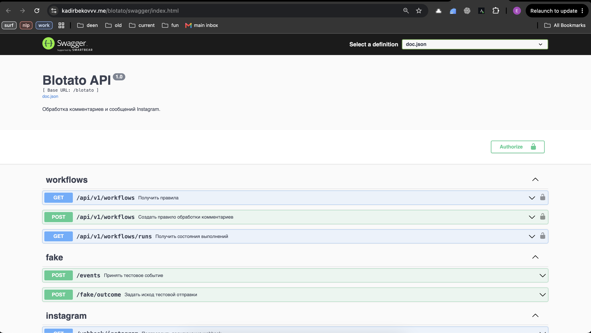
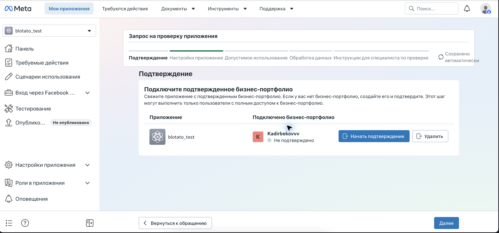
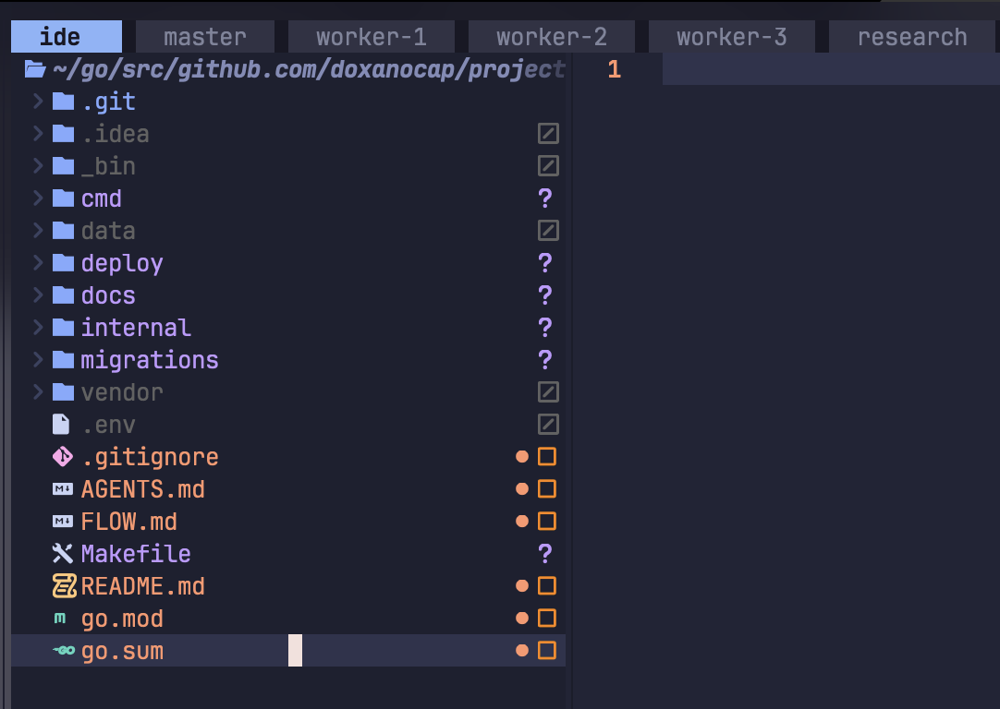

# Blotato take-home

## Proof of concept

**A live backend is deployed over HTTPS. You can send API requests to it or use Swagger's "Try it out".**

- **Live API base URL:** `https://kadirbekovvv.me/blotato`
- **Interactive Swagger:** [https://kadirbekovvv.me/blotato/swagger/index.html](https://kadirbekovvv.me/blotato/swagger/index.html)
- **API specification:** [https://kadirbekovvv.me/blotato/swagger/doc.json](https://kadirbekovvv.me/blotato/swagger/doc.json)
- **How to test:** [public checks](docs/tasks/2026-1029-plan-verification.md#public-checks) and [complete local walkthrough](docs/tasks/2026-1029-plan-verification.md#full-scenario)

With administrator access, use `GET` / `POST /api/v1/workflows` to list/create rules and `GET /api/v1/workflows/runs` to inspect execution state. Prefix these paths with the API base URL above. Request `BLOTATO_ADMIN_TOKEN` from the author privately and enter `Bearer <token>` in Swagger's Authorize dialog. Without it, management endpoints return `401`.

Implemented: `pricing` comment → public reply **"Sent you a DM!"** → private reply asking for an email → persisted wait → email response → DM with a link.

- [Architecture, data model and execution diagrams](docs/tasks/2026-1028-plan-start.md#schemas)
- [Original assignment](docs/tasks/2026-1028-plan-start.md#scope) · [Repository](https://github.com/doxanocap/blotato)

**Jev email intent:** optional classification of the intent in replies containing an email address. The feature exists; real model quality has not been measured. `OPENROUTER_API_KEY` is required at startup; `BLOTATO_EMAIL_INTENT_ENABLED` separately enables classification. See [Jev verification](docs/tasks/2026-1029-plan-verification.md#jev) for the full procedure.

Fake routes are local-mode tools; their presence in the shared specification does not mean they are enabled on the VPS. `/events` and `/fake/outcome` are not registered in the deployed Instagram mode.



*The live Swagger UI, with its public address visible in the browser bar.*

## Live Instagram integration: stopped at business verification

**App Review is incomplete, the Meta app is unpublished, and the real two-account Instagram scenario is not confirmed.**

The setup reached a Professional Instagram account, a connected business portfolio, Unified Login and a System User Access Token (SUAT). The service was deployed with `https://graph.facebook.com/v26.0`. Deployment checks confirmed HTTPS, authenticated rule creation/read, persistent SQLite and an exact callback challenge response. An incorrect verify token was rejected.

We stopped at the requirement to verify the business portfolio during App Review. I chose not to continue that administrative process for this take-home. Verification and App Review remain unfinished. A successful challenge confirms our endpoint behavior; it does not establish Meta subscriptions or real event/message delivery.



*Meta requires a verified business portfolio. The connected portfolio is unverified and App Review is incomplete.*

The [assignment](docs/tasks/2026-1028-plan-start.md#scope) explicitly permits assuming that receiving comments/messages, replying to comments and sending platform messages already work. The core workflow is implemented and demonstrated locally; live platform access is a separate unfinished step.

## AI-assisted development

I did not write a single line of application code manually.

I defined scope, discussed architecture, assigned tasks, reviewed results and configured Meta. AI agents wrote the code. I passed assignments and results between agents, agreed ownership before parallel work and reviewed each round before moving on.

| Role | Work |
|---|---|
| `master` | Discussed decisions, prepared assignments, reviewed code read-only and reconciled results. |
| `worker-1`, `worker-2`, `worker-3` | Implementation, testing, deployment and documentation across iterations. |
| `research` | Meta documentation, identifiers and access/review constraints. |

The implementation handoff supplied a binary and SHA-256; deployment verified that hash, released the service and checked HTTPS and persistence. Local test results and Meta research fed into this documentation.



*Five agent tabs: master, three workers and research.*

This describes the development process as reported by the author. The screenshot illustrates the workspace organization; it is not proof of complete code authorship.

## References

- [Architecture and original assignment](docs/tasks/2026-1028-plan-start.md)
- [How to verify: API requests, local scenario and Jev](docs/tasks/2026-1029-plan-verification.md)
- [Development plan](docs/tasks/2026-1028-init.md)
- [Deployment and release status](docs/tasks/2026-1029-plan-release-v0.1.md)

## Architecture and decisions

One API process runs two background jobs: outgoing workflow actions and optional email-intent decisions. SQLite is the durable queue and state store; there is no broker or separate worker deployment.

Rules match comments by case-insensitive substring; the lowest matching rule ID wins. Each run snapshots the keyword, reply, question, link and 24-hour wait duration. Rule editing/deletion is not exposed; changing stored settings does not change an existing run.

| Layer | Responsibility |
|---|---|
| [Application](internal/app/api/app.go) | Configuration, wiring, recovery before HTTP startup, shutdown. |
| [Controllers](internal/io/api/controllers/workflows) | Bind requests, verify/normalize webhooks, call services, return JSON. |
| [Rule service](internal/domain/service/automation/workflows.go) / [resolver](internal/domain/service/resolver/workflows.go) | Validate rules and select the first match. |
| [Workflow service](internal/domain/service/workflow) | Receive events, execute steps, persist waits and outcomes. |
| [Repository](internal/repo/sqlite) | SQL and transactions through a shared [base repository](internal/repo/sqlite/base/repo.go). |
| [Instagram client](internal/clients/instagram) / [fake client](internal/clients/fake) | Platform HTTP calls or controlled local outcomes. |

The rule-management package is currently named `automation`; the API and stored rules use `workflows`.

| Table | Stored state |
|---|---|
| `workflows` | Keyword, public reply, email question and link. |
| `inbox` | External event ID, account/contact, text, receipt time and platform time. |
| `runs` | Rule snapshot, contact, state, deadline, email and answer time. |
| `actions` | Step, send status, platform confirmation ID and safe error code. |
| `email_decisions` | Optional Jev decision, model, instruction version and confidence, keyed by inbox event. |

[SQL schema](migrations/sqlite/001_init.sql) · [Entities and DTOs](internal/domain/entity) · [Usecase, implementation and domain diagrams](docs/tasks/2026-1028-plan-start.md#schemas).

The fixed state machine is deliberate: three sends and one wait make transitions and failure boundaries explicit. SQLite keeps state and the action queue in one transaction without a broker. One process keeps recovery ownership clear.

Rules configure the existing sequence, not arbitrary graphs. Another scenario would need a type/version and its own transitions while reusing inbox, actions and recovery. Multiple simultaneous conversations need an explicit reply-correlation rule.

### Jev inside the product

A plain valid email follows deterministic rules. With `BLOTATO_EMAIL_INTENT_ENABLED=true`, a message containing an address within surrounding text can queue an email-intent decision through OpenRouter.

The candidate address is replaced with `EMAIL_0`; acceptance requires the expected model snapshot, an affirmative choice and confidence of at least `0.95`. Other message text still reaches the provider. Decisions, model and instruction version are saved in `email_decisions`. Network work runs outside the webhook transaction in a separate job.

Jev is disabled in the deployed service and local demo. `OPENROUTER_API_KEY` is currently required even when disabled. Tests use a stub provider; **real Jev quality has not been measured**. [Implementation](internal/domain/service/workflow/email_decision.go) · [Client](internal/clients/jev/client.go) · [Experiment and synthetic cases](docs/email-intent-experiment.md).

## Run and reproduce

A safe local template is available in [.example.env](.example.env). Real credentials belong in the ignored `.env` file.

Go 1.26.4. Local reproduction uses fake sending, temporary SQLite and no real Meta/model calls. The [verification guide](docs/tasks/2026-1029-plan-verification.md#local-start) supplies the complete environment and API requests; environment variables override the optional `.env`.

Worker-1 reported a passing full race run on 2026-10-29. The HTTP demonstration used the actual application and SQLite with a local Graph server: **three platform requests, one run, two inbox events, completed**, including restart and duplicate delivery. [Full test output](docs/assets/demo/tests.txt).

```sh
GOPROXY=off GOSUMDB=off go test -race -count=1 ./...
GOPROXY=off GOSUMDB=off go test -race -count=1 \
  -run '^TestReleaseInstagramHTTPFlow$' -v ./internal/app/api
```

## Reliability and limitations

Webhook signature verification uses the original request bytes. Each relevant event commits its inbox record and immediate state/action changes in one transaction before acknowledgement. A batch storage failure returns `503`; replaying previously committed events is safe.

The worker commits `pending → sending`, performs HTTP outside the transaction, then commits the outcome and next step together. The first private reply uses the comment ID; subsequent DM uses the scoped contact ID. DM confirmations must match that contact.

| Case | Decision |
|---|---|
| Duplicate webhook | Unique `(platform, account_id, kind, event_id)` prevents duplicate processing. |
| Concurrent comments/answers | One SQLite connection serializes transactions. A partial unique index permits one active run per account/contact; `(run_id, step)` is unique. |
| New comment during an active run | Persisted without starting another run or queuing a future conversation. |
| Early answer | Deferred while the question is sending/unknown; replayed after confirmed acceptance. An answer before question sending is not reused. |
| Restart | Waiting state and pending actions survive. Interrupted `sending` becomes `unknown` before processing resumes. |
| Timeout, lost response, ambiguous result | `unknown`, without automatic retry. The run blocks another active run for that contact. |
| Definite local rejection | `failed`, with a safe reason. The Instagram client currently treats all non-200 responses as `unknown`, including 4xx. |
| Expired wait | Closed before every action claim, even with a nonempty queue. |

The wait is 24 hours from confirmed acceptance of the question. Before sending the link, the platform answer timestamp must be known, not in the future and less than 24 hours old. Receipt time and platform time serve different checks. Platform acceptance is not delivery/read confirmation.

There is no atomic transaction between SQLite and Meta. Avoiding duplicate sends after an ambiguous outcome takes priority over automatic completion. Manual reconciliation of `unknown` is not implemented. These guarantees assume one application process owns the database, not multiple replicas or a failed disk.

[Application test](internal/app/api/app_test.go) · [Workflow tests](internal/domain/service/workflow/service_test.go) · [Instagram client tests](internal/clients/instagram/client_test.go) · [Email-decision tests](internal/domain/service/workflow/email_decision_test.go).

Unverified: live Meta permissions/subscriptions, account/contact identifier equivalence and real message delivery. Not implemented: manual resolution of `unknown`, multi-account operation, multiple replicas, rate scheduling or production metrics. A new source change requires new validation; the deployed artifact and current worktree are separate evidence.
