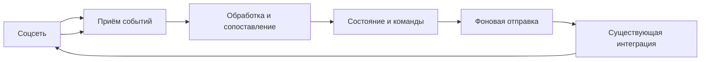
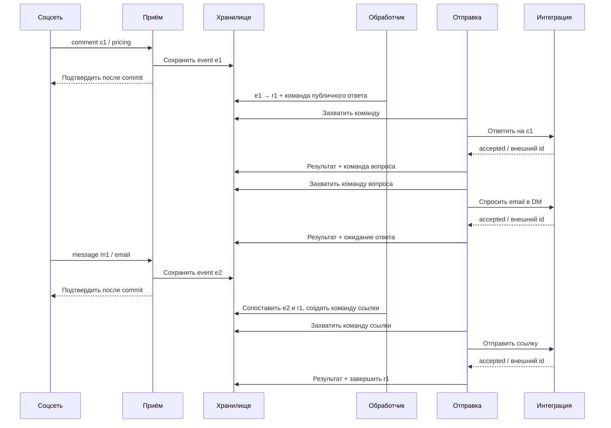
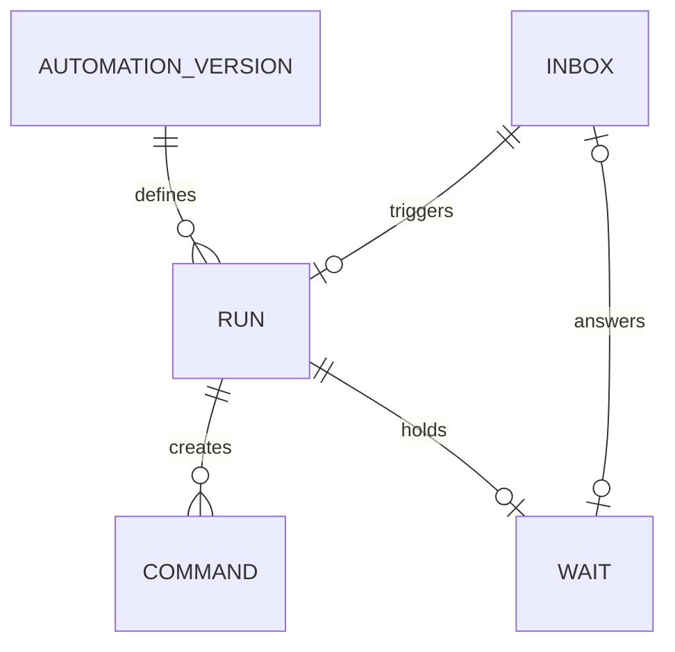
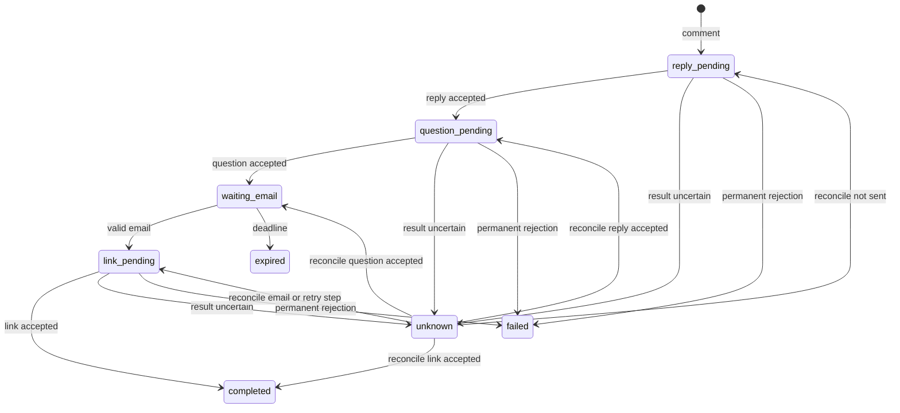

### Goal

1. Разобраться, как работает comment-to-DM: продукт, интеграция с соцсетью, исполнение и сбои.
2. Подготовить обоснование architecture, data model и execution model для тестового. Стек и архитектура пока не выбраны.

### Scope

1. **Исходное задание.**

> Blotato Take Home
>
> We want to let customers create automations that begin when someone comments on one of their social media posts.
>
> For example:
>
> When someone comments "pricing" on any Instagram post:
>
> 1. Reply to the comment with "Sent you a DM!"
> 2. Send the user a DM asking for their email address.
> 3. Wait for the user to respond.
> 4. Once an email address is received, send them another DM containing a link.
>
> Design the backend system that would support this automation.
>
> You are free to decide how general or extensible the automation system should be, as long as you explain and justify your decisions.
>
> This feature already exists in my product. I am not evaluating whether your solution matches my implementation; I am evaluating your reasoning and engineering decisions.
>
> You can assume the system already supports receiving comments and messages, replying to comments, and sending messages to social media platforms.
>
> Describe the architecture, data model, and execution model, as well as any important reliability or concurrency considerations.
>
> In addition, include a short write-up describing which parts of your solution you developed yourself and where you used AI.
>
> Reply to this message with the github repo link.
>
> NOTE: Blotato legally confirms that your code will *not* be used outside of this interview process. It is YOUR code fully belonging to you, and I have no rights to use it.

2. **Что дано.** Комментарий `pricing` → публичный ответ → вопрос об email в DM → ожидание → ссылка в DM. Порядок указан в условии. Приём комментариев и сообщений, публичный ответ и отправка DM можно считать существующими. Обязательность кода отдельно не указана.

3. **Зачем это нужно.** Бренд превращает комментарий в личный разговор: получает контакт и выдаёт материал без ручной обработки каждого обращения. Настройка сценария общая, но состояние и ожидание ответа принадлежат отдельному запуску. Email не означает согласие на рассылку. Пример продукта: [Manychat Auto-DM](https://help.manychat.com/hc/en-us/articles/16654065283100-Quick-Automation-Auto-DM-links-from-comments).

4. **Путь события.** Это схема предметного процесса, не выбранная архитектура.

   ```mermaid
   sequenceDiagram
       participant U as Посетитель
       participant S as Соцсеть
       participant I as Интеграция
       participant A as Автоматизация
       U->>S: Комментарий pricing
       S-->>I: Webhook комментария
       I-->>A: Событие
       A->>I: Ответить на комментарий и спросить email в DM
       I->>S: Публичный ответ, затем DM
       Note over A: Ожидание ответа
       U->>S: Email в DM
       S-->>I: Webhook сообщения
       I-->>A: Событие
       A->>I: Отправить ссылку в DM
       I->>S: Отправка
   ```

   Интеграция подключает аккаунт, подписывается на события и принимает webhook от платформы. Для реального подключения нужно проверить подтверждение подписки, проверку подлинности запросов, идентификаторы и контракт ошибок. В задании эти операции приёма и отправки уже даны; их гарантии не указаны. Приём события, попытка отправки, подтверждение платформы и прочтение - разные результаты.

5. **Что уже известно.** [Meta Private Replies](https://developers.facebook.com/documentation/instagram-platform/private-replies) описывает ограничения первого DM и окна последующего общения. [Meta Webhooks](https://developers.facebook.com/documentation/instagram-platform/webhooks) описывает повторную доставку некоторых событий. Источники прочитаны через индекс официальной документации; перед настоящей интеграцией проверить актуальные правила конкретного API. По прочитанной версии Meta: первый private reply на комментарий к посту или Reels доступен один раз в течение 7 дней; для Live действуют отдельные условия. Последующие сообщения разрешены после ответа человека в пределах 24 часов. Это ограничения конкретного канала, не универсальные правила. Порядок событий и гарантии отправки в условии не заданы.

6. **Основные сложности.**
   - Повтор webhook и новый комментарий одного человека - разные события. Как не запустить сценарий дважды из-за повтора?
   - Человек отвечает позже или очень быстро. Как сохранить ожидание после остановки процесса и не потерять ранний ответ?
   - Два запуска ждут email в одном диалоге. Как определить, какой запуск продолжить?
   - Два обработчика одновременно получили ответ. Кто продолжает сценарий и отправляет ссылку?
   - Платформа могла отправить DM, но подтверждение потерялось. Повтор может создать дубликат; отказ от повтора - потерять сообщение. [AWS: безопасные повторы](https://aws.amazon.com/builders-library/making-retries-safe-with-idempotent-APIs/); поддержка идемпотентности конкретным API пока неизвестна.
   - Публичное «Sent you a DM!» может появиться до отказа DM. Как объяснить частичный успех?
   - Ответ и истечение срока могут происходить одновременно. Нужны правило победителя и определение времени, по которому оно работает.
   - Фильтр должен различать подходящий комментарий, служебное событие и исходящее эхо. Правила регистра, целого слова и неверного ввода пока открыты. Примеры типов событий: [Meta Webhook Examples](https://developers.facebook.com/documentation/instagram-platform/webhooks/examples).
   - Отключить новые запуски, завершить ожидания и отменить ещё не отправленные сообщения - разные действия. Изменение ссылки также ставит вопрос о версии предложения для уже начатого разговора.
   - Несколько брендов, ограничение скорости, отзыв доступа и ручное вмешательство требуют изоляции аккаунтов и понятной причины остановки. Email не должен без необходимости попадать в логи.
   - Для поддержки нужно восстановить путь конкретного запуска: какой комментарий подошёл, что отправлено, что ожидается и почему произошёл отказ. Число запусков, полученных email и отправленных ссылок - разные показатели; принятие платформой не означает прочтение или продажу.

7. **Что читать.**
   - [Blotato API](https://help.blotato.com/start-with-an-ai-agent/llm.md#api-api-reference-dm-automations) - настройки, запуски, журналы, ожидание email, срок ожидания и версия для начатого запуска. [FAQ](https://help.blotato.com/support/faqs.md) описывает комментарии и DM. Это сведения о продукте, не требование повторить его решения; внутреннее устройство неизвестно.
   - [Manychat: trigger](https://help.manychat.com/hc/en-us/articles/14281316989724-Instagram-Post-and-Reel-Comments-trigger) и [сбор данных](https://help.manychat.com/hc/en-us/articles/18362925739932-Data-Collection-Block) - выбор постов и слов, тип ответа, срок и повторы вопроса. [Conversation routing](https://help.manychat.com/hc/en-us/articles/14281188830748-Conversation-Routing-for-Instagram) показывает сосуществование приложений, [wrong messages](https://help.manychat.com/hc/en-us/articles/14281436380956-Manychat-is-sending-wrong-messages) - поиск конфликтующих правил. Свойства продукта не равны ограничениям всей платформы.
   - [Chatfuel](https://sdk.chatfuel.com/channels/instagram) - входы в переписку и передача сотруднику. [respond.io: вопрос](https://respond.io/help/workflows/step-ask-a-question) и [остановка](https://respond.io/help/workflows/workflows-overview) - варианты исходов ожидания и ручного вмешательства.
   - [chatmany: состояния](https://github.com/ryanlaiyanip-ctrl/chatmany/blob/285ddd546aeb88db8e7900687a087162ef877a6a/src/engine/transitions.ts) и [engine](https://github.com/ryanlaiyanip-ctrl/chatmany/blob/285ddd546aeb88db8e7900687a087162ef877a6a/src/engine/engine.ts) - email может продолжить несколько кампаний; при некоторых сетевых ошибках попытка считается успехом ради отказа от повтора. Это выбор автора с риском потери, не доказательство доставки.
   - [instagram-cta-kit: ADR](https://github.com/dangogit/instagram-cta-kit/blob/b4b99cec6954ba8d5ffa7f185719172b8b3799aa/docs/adr/0001-runtime-and-state.md) и [recovery test](https://github.com/dangogit/instagram-cta-kit/blob/b4b99cec6954ba8d5ffa7f185719172b8b3799aa/test/durable-recovery.test.mjs) - решение ограничено одним активным процессом и одним владельцем; восстановление обработки само по себе не исключает повторную внешнюю отправку.
   - [Chatwoot: webhook](https://github.com/chatwoot/chatwoot/blob/7fe41fe03731fc2f5b1841b84351386962d2fd05/app/services/instagram/webhooks_base_service.rb) и [отправка](https://github.com/chatwoot/chatwoot/blob/7fe41fe03731fc2f5b1841b84351386962d2fd05/app/services/instagram/base_send_service.rb) - контакт в контексте канала и результат отправки; [n8n Wait](https://docs.n8n.io/integrations/builtin/core-nodes/n8n-nodes-base.wait) - пауза и продолжение исполнения.
   - [chatmany: adversarial tests](https://github.com/ryanlaiyanip-ctrl/chatmany/blob/285ddd546aeb88db8e7900687a087162ef877a6a/test/adversarial.test.ts), [instagram-cta-kit: durable inbox](https://github.com/dangogit/instagram-cta-kit/blob/b4b99cec6954ba8d5ffa7f185719172b8b3799aa/src/durable-inbox.mjs) и [n8n: wait tracker](https://github.com/n8n-io/n8n/blob/281ce2cc011cab8535e194b3f6bab58cd932d654/packages/cli/src/wait-tracker.ts) - точки для дальнейшего чтения. [Chatwoot issue](https://github.com/chatwoot/chatwoot/issues/11564) - жалоба об окне ответа, без воспроизведения.
   - В исходном исследовании прочитаны выбранные файлы и публичные страницы, не все системы целиком; тесты не запускались. У Chatwoot и n8n разные условия лицензирования частей кода: [Chatwoot LICENSE](https://github.com/chatwoot/chatwoot/blob/7fe41fe03731fc2f5b1841b84351386962d2fd05/LICENSE), [n8n LICENSE](https://github.com/n8n-io/n8n/blob/281ce2cc011cab8535e194b3f6bab58cd932d654/LICENSE.md).

8. **Что проверяет тестовое.** Прямо указаны architecture, data model, execution model, надёжность, конкурентность и обоснование расширяемости. Наш вывод: стоит показать последствия продуктовых правил при сбоях и явно назвать границы гарантий. Внутренние критерии оценки и ожидаемый объём реализации неизвестны.

9. **Как двигаться.**
   1. Описать правила одного сценария: старт, повторное участие, ввод, ожидание, завершение и ошибки.
   2. Разобрать несколько ожидающих сценариев, конкурентный ответ и неизвестный результат отправки. Сравнить последствия вариантов.
   3. Проверить один близкий сценарий и сравнить: один тип кампании проще, но каждое расширение потребует кода; небольшой набор действий гибче, но добавляет правила их сочетания. Универсальная платформа существенно расширяет задачу.
   4. После выбора поведения описать данные, исполнение и гарантии интеграции. Определить, нужен ли небольшой исполняемый пример и что он должен проверять.

10. **Открытые решения.**
   - Как отличать повтор доставки от нового участия?
   - Какой запуск получает ответ, если ждут несколько?
   - Когда повторять отправку с неизвестным результатом?
   - Что делать с ожиданиями при отключении или изменении сценария?
   - Как обрабатывать неверный email, молчание и истечение срока?
   - Какой объём расширяемости и примера оправдан? Какие гарантии интеграции допустимо предположить?

11. Этот plan хранит контекст и варианты решения. Порядок реализации, проверки двумя аккаунтами и облачной поставки находится в отдельном [init](2026-1028-init-mvp-delivery.md); принципы работы - в [FLOW.md](../../FLOW.md). Технические схемы ниже не обязывают включать все компоненты в MVP.

### Decisions

1. Здесь сохраняем исследование и технические варианты; текущую траекторию дешёвого живого MVP определяют FLOW и init. Открытые решения выбираем по мере необходимости поставки.
2. Git инициализирован локально, ветка `master`; remote `origin` настроен, база для этой задачи не выбрана.

### Changes

1. `docs/tasks/2026-1028-plan-start.md` - объединены условие, источники и предлагаемая техническая модель.
2. Текущая траектория поставки и распределение работы вынесены в отдельный init; технические варианты сохранены как контекст.


## Schemas
<!-- dox-schema:managed-v1 -->

Все схемы и контракты ниже - **наш рабочий пример**, не API Meta и не описание внутренностей Blotato. Это модель для проверки вариантов: хранение и фоновая обработка могут быть реализованы разными технологиями. Ни сервис, ни гарантии внешней интеграции не проверены.

### Usecase



Sources: исходное задание выше; остальные связи - предлагаемая модель.

### Implementation

Один проход: `account=a1`, `contact=u1`, `comment=c1`, `run=r1`. Для примера считаем, что идентификаторы события и отправителя устойчивы внутри аккаунта, а интеграция различает входящие сообщения и эхо. Это нужно проверить для реального контракта.



Sources: исходное задание; события, команды, границы commit и результаты - наш пример.

**Контракты.** Примеры намеренно сокращены. `event_id` ниже - устойчивый идентификатор исходного события, если интеграция его предоставляет; собственный `inbox_id` не заменяет его для дедупликации.

```json
{"kind":"comment.created","event_id":"c1","account_id":"a1","contact_id":"u1","post_id":"p1","text":"pricing","occurred_at":"2026-10-28T10:00:00Z"}
{"kind":"message.received","event_id":"m1","account_id":"a1","contact_id":"u1","text":"person@example.com","occurred_at":"2026-10-28T10:05:00Z"}
{"command_id":"cmd1","run_id":"r1","kind":"reply_comment","account_id":"a1","comment_id":"c1","text":"Sent you a DM!"}
{"command_id":"cmd2","run_id":"r1","kind":"send_question","account_id":"a1","contact_id":"u1","comment_id":"c1","text":"What is your email address?"}
{"command_id":"cmd3","run_id":"r1","kind":"send_link","account_id":"a1","contact_id":"u1","text":"https://example.com/pricing"}
{"command_id":"cmd2","outcome":"accepted","external_message_id":"out2"}
```

`accepted` означает подтверждение интеграции, не прочтение. Другие результаты: `retryable` - доказано, что действие не выполнено и повтор разрешён; `rejected` - постоянный отказ; `unknown` - отправка могла состояться. Если интеграция не различает эти случаи, считать неоднозначный результат `unknown`. `command_id` служит нашей идентичностью намерения; внешний ключ идемпотентности передаётся только если реальный контракт его поддерживает.

Сопоставление в этом примере: `e1` ищет активное правило аккаунта `a1`, подходящее посту и тексту; `e2` ищет ожидающий запуск по `(account_id, contact_id)`. Вариант модели допускает один активный запуск на эту пару. Атомарный резерв пары создаётся вместе с `run` до отправки вопроса и удерживается до завершения, ошибки или отмены. Новый подходящий комментарий сохраняется в отложенном inbox, но запуск откладывается до освобождения пары; для явного нового комментария создаётся отдельный запуск. Альтернатива - несколько ожиданий: нужны приоритет или явный идентификатор запроса в ответе; применение одного ответа ко всем меняет продуктовую семантику. Один лишь порядок webhook не доказывает намерение человека.

**Границы работы.**

1. Приём проверяет происхождение и нормализует событие, затем в одной транзакции вставляет inbox с уникальным ключом `(platform, account_id, kind, event_id)`. Подтверждение webhook - после commit. При сбое до commit источник может повторить доставку, если его контракт это допускает. При отсутствии устойчивого внешнего ID нельзя обещать такую дедупликацию: нужна отдельная политика и контракт интеграции.
2. Обработчик в транзакции блокирует или условно захватывает inbox, проверяет правило, создаёт `run` и `cmd1`, отмечает событие обработанным. Уникальность `(account_id, automation_version_id, trigger_event_id)` не даёт создать второй запуск из того же триггера. Для ответа транзакция связывает inbox с ожиданием, сохраняет email, закрывает ожидание и создаёт `cmd3`. Внешних вызовов внутри транзакции нет.
3. Фоновый исполнитель атомарно захватывает готовую команду с lease и номером попытки, фиксирует `sending`, затем вызывает интеграцию вне транзакции. После результата отдельная транзакция сохраняет исход и продвигает запуск или создаёт следующую команду. Уникальность `(run_id, step)` не даёт создать одно намерение дважды. Подтверждённый `cmd1` создаёт `cmd2`; подтверждённый `cmd2` открывает ожидание; подтверждённый `cmd3` завершает запуск. Очерёдность соответствует условию.
4. Если процесс упал до вызова, после вызова или до записи результата, один истёкший lease не доказывает, что отправки не было. Восстановление переводит такую попытку в `unknown`, если нельзя доказать отсутствие вызова. Не отправлять её автоматически повторно без подтверждённой идемпотентности или проверки у провайдера. Это консервативный вариант: возможна потеря сообщения. Другой вариант - повтор с риском дубликата; его нужно выбрать отдельно.

**Ранний ответ и срок.** Сообщение всегда сначала сохраняется в inbox, даже если вопрос ещё находится в `sending` или `unknown`. Обработчик не помечает подходящее сообщение окончательно неприменимым, пока исход вопроса не разрешён: оно остаётся `deferred`. После подтверждения `cmd2` повторно проверяем отложенные сообщения этого аккаунта и контакта. Сообщение нельзя применять к ещё не отправленному вопросу без правила: в этом примере принимаем только входящее сообщение, сохранённое после начала попытки `cmd2`; старые сообщения не переиспользуем. Это допущение, а не доказательство ответа именно на вопрос.

Срок в примере - 24 часа от записи подтверждения `cmd2` в нашем хранилище; это правило продукта для примера, не утверждение об окне Meta. Используем время **приёма в хранилище**, а не непроверенные часы платформы. Приём и timeout координируются по блокировке одного ожидания: приём присваивает `received_at` на стороне хранилища и фиксирует событие под этой блокировкой; timeout после захвата сначала проверяет подходящие зарегистрированные сообщения с `received_at < deadline`. Ровно в `deadline` побеждает timeout. Если событие доставлено платформой после срока, оно опоздало по этому правилу, даже если пользователь написал раньше. Обработка сообщений также атомарно захватывает ожидание; уникальная связь `inbox_id` с обработкой и условное обновление открытого ожидания исключают два победивших продолжения. Альтернатива - время платформы и период задержки для поздней доставки: точнее к времени пользователя, но зависит от достоверности времени и верхней границы задержки.

### Domain



Sources: поля и связи ниже - предлагаемая модель, не существующая схема данных.

| Сущность | Поля и смысл | Ограничение |
|---|---|---|
| `automation_version` | `id`, `account_id`, условие, тексты, ссылка, `active` | Версия неизменяема после публикации; запуск фиксирует её `id`. Отключение новых запусков отдельно от отмены существующих. |
| `inbox` | `id`, `platform`, `account_id`, `kind`, `event_id`, `contact_id`, `payload`, `received_at`, `status` | Уникальный внешний ключ события в пределах платформы, аккаунта и типа; `deferred` сохраняет ранний ответ. Срок хранения и доступ к payload ограничены. |
| `run` | `id`, `automation_version_id`, `account_id`, `contact_id`, `trigger_event_id`, `state`, `version` | Уникальный триггер на версию правила; уникальный активный резерв `(account_id, contact_id)` и `version` или блокировка защищают конкурентный переход. |
| `wait` | `run_id`, `account_id`, `contact_id`, `status`, `opened_at`, `deadline`, `answer_inbox_id`, `email` | Один открытый wait на `(account_id, contact_id)` в выбранном варианте; один ответ применяется к одному wait. Email хранить с ограничением доступа и срока. |
| `command` | `id`, `run_id`, `step`, `target`, `payload`, `status`, `attempt`, `lease_until`, `external_id`, `error_class` | Один логический шаг на `(run_id, step)`; `sending` после истечения lease не считается неотправленным. |

Для диагностирования повторов полезен отдельный журнал попыток: `command_id`, `attempt`, время, исход и внешний ID. Не писать туда содержимое email или секреты. Если продукт разрешит несколько ожиданий, уникальность по паре нужно заменить явной политикой выбора; если одну реплику применять ко многим запускам, связь ответа и ожиданий станет многие-ко-многим.

**Согласованный пример данных.** `e1` и `e2` - наши локальные `inbox.id`; `c1` и `m1` - внешние идентификаторы событий. Время указано только для примера.

| Момент | Записи после фиксации транзакции |
|---|---|
| Настройка | `automation_version v1`: `account_id=a1`, слово `pricing`, ссылка `https://example.com/pricing`, `active=true`. |
| Комментарий | `inbox e1`: `event_id=c1`, `contact_id=u1`, `processed`; `run r1`: `version_id=v1`, `trigger_event_id=c1`, `state=reply_pending`; `cmd1`: `step=reply_comment`, `pending`. |
| Публичный ответ принят | `cmd1=accepted`, `external_id=out1`; `r1=question_pending`; `cmd2`: `step=send_question`, `pending`. |
| Вопрос принят в 10:01 | `cmd2=accepted`, `external_id=out2`; `r1=waiting_email`; `wait`: `run_id=r1`, `open`, `opened_at=2026-10-28T10:01:00Z`, `deadline=2026-10-29T10:01:00Z`. |
| Сообщение в 10:05 | `inbox e2`: `event_id=m1`, `received_at=2026-10-28T10:05:00Z`, `processed`; `wait=answered`, `answer_inbox_id=e2`, `email=person@example.com`; `r1=link_pending`; `cmd3`: `step=send_link`, `pending`. |
| Ссылка принята | `cmd3=accepted`, `external_id=out3`; `r1=completed`. Это не подтверждает прочтение ссылки. |

**Состояния одного запуска.** `unknown` и `failed` сохраняют причину и шаг; они не означают завершение отправки.



При `unknown` сохраняем `step`: для неотправленного действия возвращаемся к соответствующему pending, для подтверждённого - к следующему состоянию. Если вопрос подтверждён после раннего ответа, открываем ожидание и повторно обрабатываем `deferred`. Для разрешения `unknown` нужна проверка у провайдера либо ручное решение; сам lease подтверждения не даёт. Неверный email в этом примере оставляет ожидание открытым; число уточняющих сообщений и политика отказа ещё не выбраны. `completed`, `expired` и `failed` - разные исходы.

**Что проверить на модели до выбора реализации:** повтор одного `c1`; два конкурирующих обработчика `m1`; `m1` до подтверждения `cmd2`; `m1` на границе срока; падение после внешней отправки до записи результата; отказ DM после публичного ответа; перезапуск с открытым wait и истёкшим lease. Для каждого проверить состояние inbox, run, wait и command, а также число внешних попыток.
