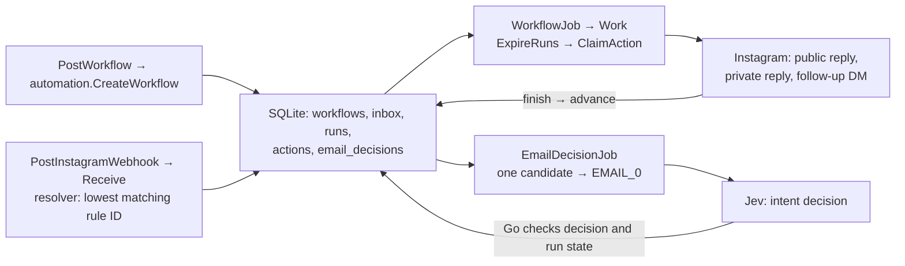
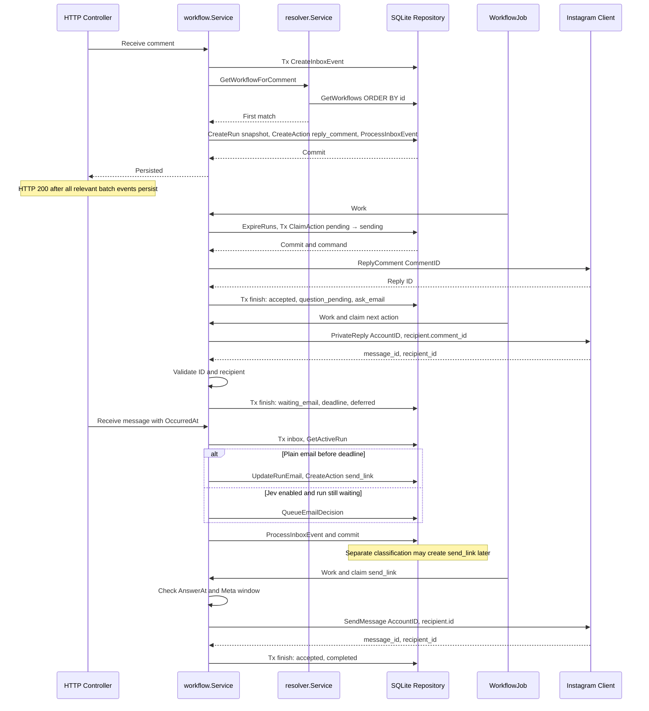
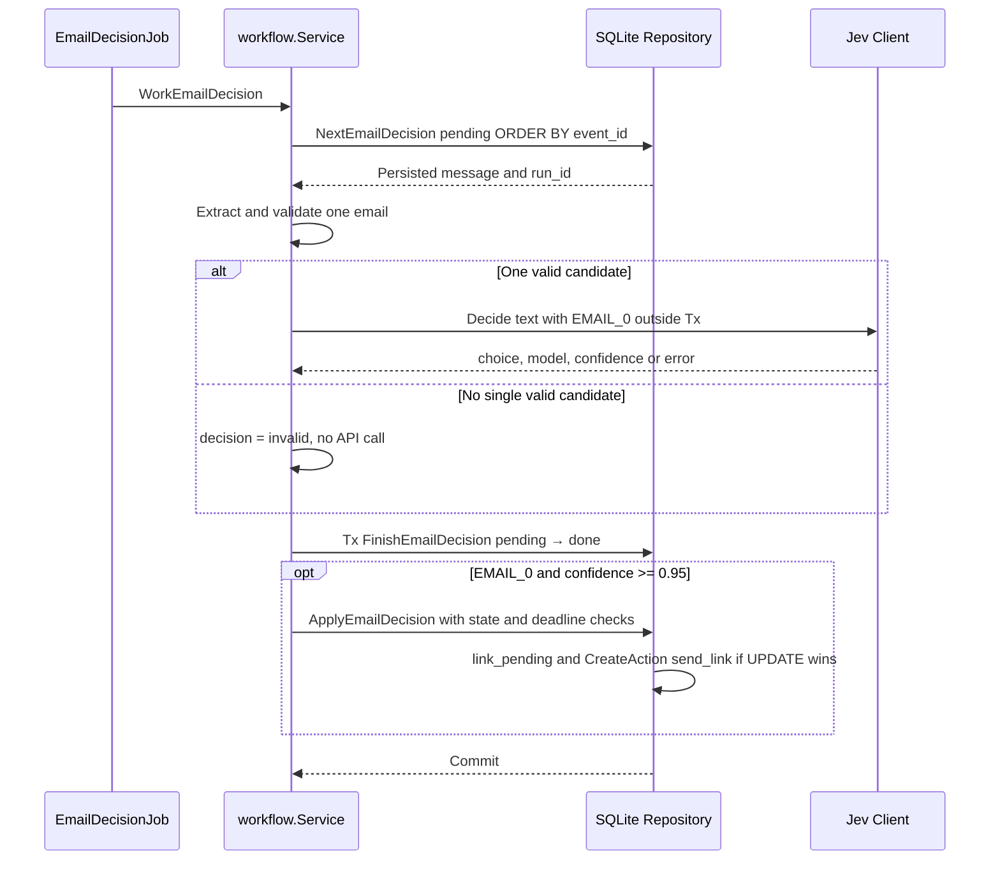
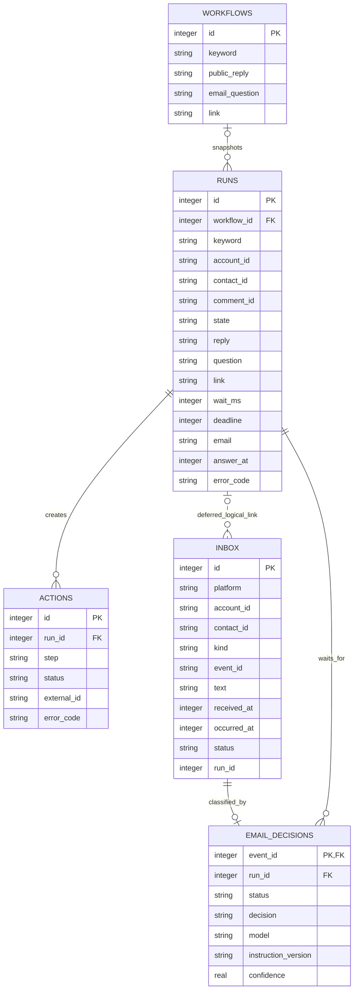

### Goal

1. Implement the requested comment → reply → email question → wait → link flow.
2. Explain the decisions, failure behavior and extension points.

### Scope

#### Original assignment

> Blotato Take Home
>
> We want to let customers create automations that begin when someone comments on one of their social media posts.
>
> For example:
>
> When someone comments "pricing" on any Instagram post:
>
> 1. Reply to the comment with "Sent you a DM!"
> 2. Send the user a DM asking for their email address.
> 3. Wait for the user to respond.
> 4. Once an email address is received, send them another DM containing a link.
>
> Design the backend system that would support this automation.
>
> You are free to decide how general or extensible the automation system should be, as long as you explain and justify your decisions.
>
> This feature already exists in my product. I am not evaluating whether your solution matches my implementation; I am evaluating your reasoning and engineering decisions.
>
> You can assume the system already supports receiving comments and messages, replying to comments, and sending messages to social media platforms.
>
> Describe the architecture, data model, and execution model, as well as any important reliability or concurrency considerations.
>
> In addition, include a short write-up describing which parts of your solution you developed yourself and where you used AI.
>
> Reply to this message with the github repo link.
>
> NOTE: Blotato legally confirms that your code will *not* be used outside of this interview process. It is YOUR code fully belonging to you, and I have no rights to use it.

#### Implementation boundary

The MVP supports one connected brand account, configurable rules and a fixed sequence of three sends. The assignment permits treating platform operations as existing; an Instagram adapter was added for a live demonstration. Local simulation and deployment passed their recorded checks; real delivery remains unverified. See [verification](2026-1029-plan-verification.md) and [release](2026-1029-plan-release-v0.1.md).

A rule matches a case-insensitive substring. The lowest matching ID wins: `price` can match `pricey`, and a longer keyword has no priority. An active run blocks another run for the same account/contact. Completed, failed or expired runs allow a new comment to start again.

#### Instagram integration

Use Unified Login, a Business Integration System User Access Token (SUAT) and `https://graph.facebook.com/v26.0`. Required permissions: `instagram_basic`, `instagram_manage_comments`, `instagram_manage_messages`. Resolve the brand through `/me/assigned_instagram_accounts`; `/me` identifies the system user.

| Operation | Addressing |
|---|---|
| Public reply | `POST /{comment_id}/replies`, body `message` |
| First private reply | `POST /{account_id}/messages`, `recipient.comment_id` |
| Link after the user's answer | Same messages endpoint, `recipient.id` set to the contact's scoped ID |
| Incoming comment | Account from `entry.id`; comment from `value.comment_id` or `value.id`; contact from `value.from.id` |
| Incoming text DM | Account from recipient/entry; contact from sender; event ID from `message.mid`; platform time from millisecond `timestamp` |

The controller accepts direct `field/value` and `changes[]` comment envelopes, filters other accounts and service/echo messages, then persists normalized events. All IDs are strings. Actual identity equivalence across comment, private reply and DM still requires a live check.

Configure `comments,messages` on both the app and the brand's account subscription. Verify the callback with the shared verify token; signed POSTs use HMAC-SHA256 of the raw body with App Secret. The endpoint is `/webhook/instagram`, externally `/blotato/webhook/instagram` behind Caddy.

App Review stopped at the verified-business-portfolio requirement. The app is unpublished; no rejection is confirmed. Token grants, subscriptions and live delivery are unverified. A server challenge response proves endpoint behavior only.

Sources: [Meta migration guide](https://developers.facebook.com/documentation/instagram-platform/instagram-api-with-instagram-login/migration-guide/), [Unified Login](https://developers.facebook.com/documentation/instagram-platform/instagram-api-with-unified-login/get-started/), [webhook examples](https://developers.facebook.com/documentation/instagram-platform/webhooks/examples/), [private replies](https://developers.facebook.com/documentation/instagram-platform/private-replies/).

#### Reference systems

| Reference | Useful idea | Boundary |
|---|---|---|
| [chatmany](https://github.com/ryanlaiyanip-ctrl/chatmany/tree/285ddd546aeb88db8e7900687a087162ef877a6a) | Small persistent conversation state machine | Different reply-correlation and send-failure policies |
| [instagram-cta-kit](https://github.com/dangogit/instagram-cta-kit/tree/b4b99cec6954ba8d5ffa7f185719172b8b3799aa) | Save input before acknowledgement and recover work | Durable input does not make an external send exactly-once |
| [n8n Wait](https://docs.n8n.io/integrations/builtin/core-nodes/n8n-nodes-base.wait) | Persist execution and resume it later | A general engine still needs Instagram reply correlation |

### Decisions

1. **Fixed workflow, configurable content.** Rules store keyword, reply, question and link. Runs snapshot these settings and a 24-hour wait. A different sequence needs code; a future typed/versioned workflow can reuse inbox, actions and recovery.
2. **One process and SQLite.** One connection serializes transactions. Two independent job loops handle sends and optional classification; network calls run outside database transactions.
3. **One waiting conversation per account/contact.** This makes an unaddressed email reply unambiguous. Another matching comment is recorded without starting or queuing another run.
4. **Persist before acknowledging.** Inbox insertion and immediate state/action changes commit together. A batch failure returns 503; already committed event IDs are safe to replay.
5. **Expose uncertainty.** Claim `pending → sending` before HTTP, then save outcome and the next step atomically. An interrupted send or ambiguous response becomes `unknown`, with no automatic resend or manual resolution API.
6. **Separate clocks.** The application wait starts after the question is accepted. Before sending the link, the user's platform timestamp must be known, not future, and less than 24 hours old. The first comment's age is left to Meta validation.
7. **Keep Jev bounded.** It chooses whether an existing email candidate was offered. Go controls recipients, state transitions and sends. The threshold is experimental; real quality is unmeasured.

### Changes

1. Implemented persistent rules/runs, both webhook envelopes, three send operations and optional email-intent decisions.
2. Matched the diagrams and failure rules below to the implementation. Commands and results live in [verification](2026-1029-plan-verification.md).

## Schemas
<!-- dox-schema:managed-v1 -->

### Usecase

The [rule service](../../internal/domain/service/automation/workflows.go) validates content; the [resolver](../../internal/domain/service/resolver/workflows.go) selects the first match. [`NewRun`](../../internal/domain/entity/run.go) copies settings. Editing/deleting rules and explicit workflow versions are not exposed by the API.

### Implementation

Sources: [event handling](../../internal/domain/service/workflow/events.go), [send execution](../../internal/domain/service/workflow/actions.go), [email classification](../../internal/domain/service/workflow/email_decision.go), [SQL guards](../../internal/repo/sqlite/email_decisions.go), [scheduler](../../internal/app/worker/worker.go).

- A confirmed response needs a nonempty external ID; DM recipient IDs must match. Transport errors, malformed/incomplete replies and all non-200 responses, including 4xx/429/5xx, become `unknown`. Local validation failures become `failed`.
- `ExpireRuns` executes before each action claim. It is not an independent expiry timer during a stalled Instagram request. Classification has its own loop and does not block normal sends.
- Startup and workflow-error recovery convert interrupted sends to `unknown`. Shutdown cancels both jobs and waits before closing SQLite.
- The runs API returns run/action state and safe error codes, excluding email and message text. It is not a complete event journal or an API for `email_decisions`.

**Jev contract.** [The client](../../internal/clients/jev/client.go) calls `/api/alpha/decisions` with `typesafe/jev-1.14`, accepts only snapshot `typesafe/jev-1.14-20261014`, `type=choice`, an allowed choice and confidence in `[0,1]`. Timeout: 5 seconds; response limit: 64 KiB; instruction version: `email-intent-v1`.

A plain email bypasses Jev. For prose, Go extracts one valid candidate and replaces it with `EMAIL_0`; other text still reaches OpenRouter. An affirmative choice with confidence at least `0.95` can create `send_link` only if the run is still waiting, has no accepted email, and both receipt time and application time pass the deadline checks. Error, rejection or ambiguity keeps the wait open.

Decisions persist as `pending/done`. A completed decision is not classified again, but a crash before commit can repeat inference and its cost. There is no claim/lease for multiple classifiers. A stale pending decision may still call the provider; SQL prevents it from changing a closed run. See [Jev verification](2026-1029-plan-verification.md#jev).

### Domain

[SQL schema](../../migrations/sqlite/001_init.sql) · [repository](../../internal/repo/sqlite) · [SQLite startup](../../internal/pkg/sqlite/sqlite.go)

| Entity / constraint | Meaning |
|---|---|
| `workflows` | Shared keyword and message/link settings |
| `runs` | One conversation, snapshotted settings, state, deadline and accepted email/time |
| `inbox` | External event and both receipt/platform times; unique `(platform, account_id, kind, event_id)` |
| `actions` | One send per `(run_id, step)`, with outcome and external ID |
| `email_decisions` | One decision per internal `inbox.id`; stores model, instruction version and confidence |
| Active-run index | One `(account_id, contact_id)` in reply/question/wait/link/unknown states |

`runs.workflow_id`, `actions.run_id` and decision links have foreign keys. `inbox.run_id` is a logical link for deferred messages only; normal events do not have a complete backlink. The triggering comment is identified by account and `runs.comment_id`.

Success path: `reply_pending → question_pending → waiting_email → link_pending → completed`.

| Case | Behavior |
|---|---|
| Duplicate event | No new run, action or classification |
| New comment during an active run | Recorded; no queued future conversation |
| Concurrent plain emails | The first accepted transaction creates the link action |
| Prose versus a plain email | The plain email may win while classification is running; SQL prevents overwriting it |
| Early answer | Deferred while the question is sending/unknown; resumed after accepted. Answers before sending begins are ignored |
| Restart | Waits and pending work survive; interrupted sends become `unknown` |
| Ambiguous send | Partial progress remains; no next step or automatic retry; the contact stays blocked |
| Late response | Deadline checks can reject delayed delivery or a slow model result |
| Invalid email / model error | Wait remains open; no clarification message or cancellation step |

The system assumes one process owns the database. It does not cover disk loss, multiple replicas or exactly-once external delivery. Platform acceptance is not proof of delivery, reading, email ownership or marketing consent.
