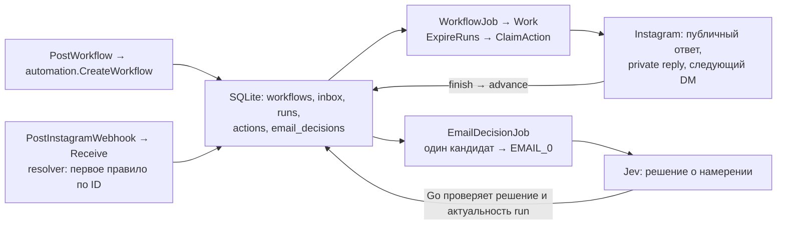
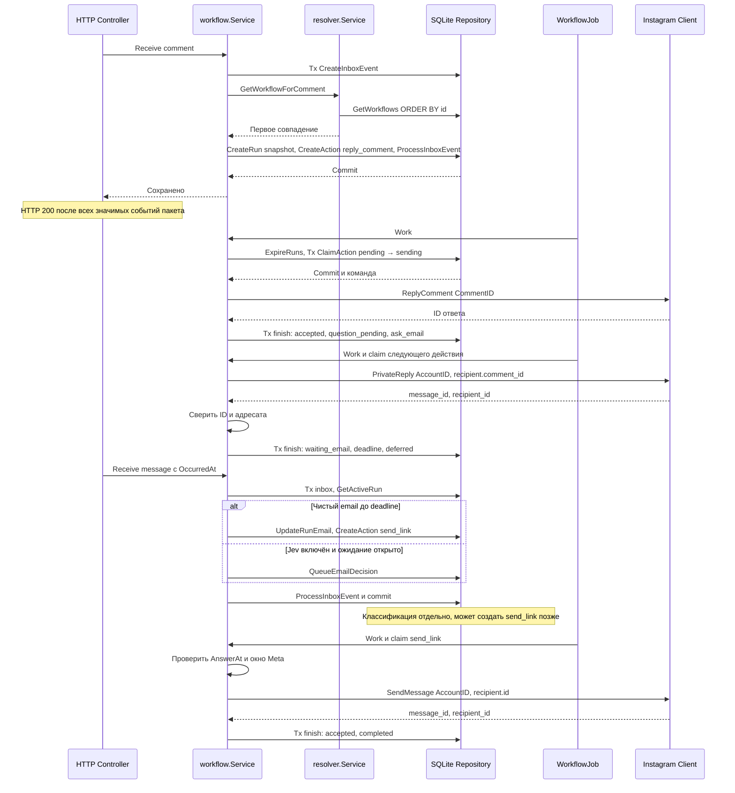
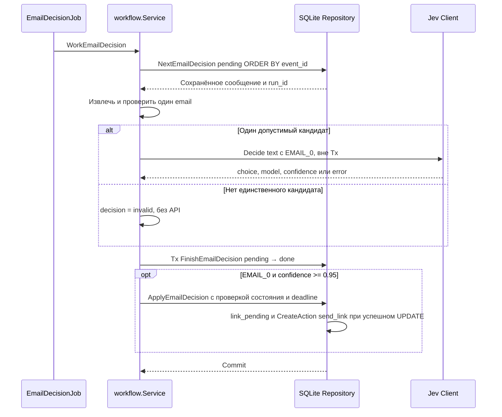
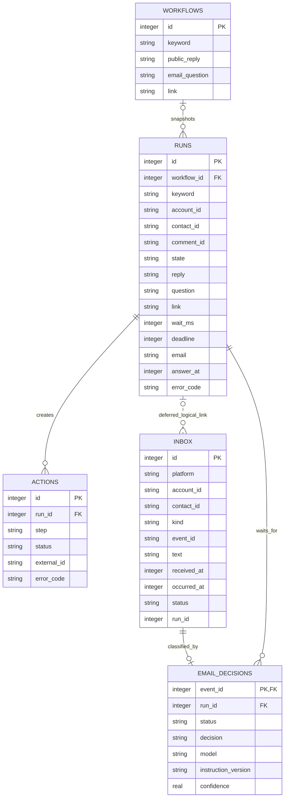

### Goal

1. Разобраться, как работает comment-to-DM: продукт, интеграция с соцсетью, исполнение и сбои.
2. Объяснить интеграцию, модель данных, исполнение и восстановление реализованного MVP на Go и SQLite. Результаты первой поставки и оставшиеся проверки описаны в [v0.1](2026-1029-plan-release-v0.1.md).

### Scope

1. **Исходное задание.**

> Blotato Take Home
>
> We want to let customers create automations that begin when someone comments on one of their social media posts.
>
> For example:
>
> When someone comments "pricing" on any Instagram post:
>
> 1. Reply to the comment with "Sent you a DM!"
> 2. Send the user a DM asking for their email address.
> 3. Wait for the user to respond.
> 4. Once an email address is received, send them another DM containing a link.
>
> Design the backend system that would support this automation.
>
> You are free to decide how general or extensible the automation system should be, as long as you explain and justify your decisions.
>
> This feature already exists in my product. I am not evaluating whether your solution matches my implementation; I am evaluating your reasoning and engineering decisions.
>
> You can assume the system already supports receiving comments and messages, replying to comments, and sending messages to social media platforms.
>
> Describe the architecture, data model, and execution model, as well as any important reliability or concurrency considerations.
>
> In addition, include a short write-up describing which parts of your solution you developed yourself and where you used AI.
>
> Reply to this message with the github repo link.
>
> NOTE: Blotato legally confirms that your code will *not* be used outside of this interview process. It is YOUR code fully belonging to you, and I have no rights to use it.

2. **Что дано.** Комментарий `pricing` → публичный ответ → вопрос об email в DM → ожидание → ссылка в DM. Порядок указан в условии. Приём комментариев и сообщений, публичный ответ и отправка DM можно считать существующими. Обязательность кода отдельно не указана.

3. **Зачем это нужно.** Бренд превращает комментарий в личный разговор: получает контакт и выдаёт материал без ручной обработки каждого обращения. Настройка сценария общая, но состояние и ожидание ответа принадлежат отдельному запуску. Email не означает согласие на рассылку. Пример продукта: [Manychat Auto-DM](https://help.manychat.com/hc/en-us/articles/16654065283100-Quick-Automation-Auto-DM-links-from-comments).

4. **Путь события.** Бренд подключает аккаунт, посетитель комментирует пост и отвечает в DM. Meta доставляет webhook нашему сервису; сервис сохраняет событие и состояние, а затем отправляет действия через Graph API. Путь, идентификаторы и границы подтверждения показаны в [Schemas](#schemas).

5. **Ограничения канала.** Первому private reply нужен комментарий, а последующему DM нужен ответ человека; для них действуют разные правила и окна. Окно приложения и окно Meta не одно и то же. См. [Private Replies](https://developers.facebook.com/documentation/instagram-platform/private-replies/) и [Unified Login](https://developers.facebook.com/documentation/instagram-platform/instagram-api-with-unified-login/get-started/). Живой путь и полный доступ конкретного приложения не подтверждены; состояние Meta описано ниже.

6. **Основные сложности.**
   - Повтор webhook и новый комментарий одного человека - разные события. Как не запустить сценарий дважды из-за повтора?
   - Человек отвечает позже или очень быстро. Как сохранить ожидание после остановки процесса и не потерять ранний ответ?
   - Два запуска ждут email в одном диалоге. Как определить, какой запуск продолжить?
   - Два обработчика одновременно получили ответ. Кто продолжает сценарий и отправляет ссылку?
   - Платформа могла отправить DM, но подтверждение потерялось. Повтор может создать дубликат; отказ от повтора - потерять сообщение. [AWS: безопасные повторы](https://aws.amazon.com/builders-library/making-retries-safe-with-idempotent-APIs/); поддержка идемпотентности конкретным API пока неизвестна.
   - Публичное «Sent you a DM!» может появиться до отказа DM. Как объяснить частичный успех?
   - Ответ и истечение срока могут происходить одновременно. Нужны правило победителя и определение времени, по которому оно работает.
   - Фильтр должен различать подходящий комментарий, служебное событие и исходящее эхо. Текущий MVP ищет подстроку без учёта регистра; чистый email принимает без модели. Включаемый отдельно Jev классифицирует намерение использовать один адрес внутри фразы; качество настоящей модели не измерено. Примеры типов событий: [Meta Webhook Examples](https://developers.facebook.com/documentation/instagram-platform/webhooks/examples).
   - Отключить новые запуски, завершить ожидания и отменить ещё не отправленные сообщения - разные действия. Изменение ссылки также ставит вопрос о версии предложения для уже начатого разговора.
   - Несколько брендов, ограничение скорости, отзыв доступа и ручное вмешательство требуют изоляции аккаунтов и понятной причины остановки. Email не должен без необходимости попадать в логи.
   - Для поддержки нужно восстановить путь конкретного запуска: какой комментарий подошёл, что отправлено, что ожидается и почему произошёл отказ. Число запусков, полученных email и отправленных ссылок - разные показатели; принятие платформой не означает прочтение или продажу.

7. **Что читать.**
   - [Blotato API](https://help.blotato.com/start-with-an-ai-agent/llm.md#api-api-reference-dm-automations) - настройки, запуски, журналы, ожидание email, срок ожидания и версия для начатого запуска. [FAQ](https://help.blotato.com/support/faqs.md) описывает комментарии и DM. Это сведения о продукте, не требование повторить его решения; внутреннее устройство неизвестно.
   - [Manychat: trigger](https://help.manychat.com/hc/en-us/articles/14281316989724-Instagram-Post-and-Reel-Comments-trigger) и [сбор данных](https://help.manychat.com/hc/en-us/articles/18362925739932-Data-Collection-Block) - выбор постов и слов, тип ответа, срок и повторы вопроса. [Conversation routing](https://help.manychat.com/hc/en-us/articles/14281188830748-Conversation-Routing-for-Instagram) показывает сосуществование приложений, [wrong messages](https://help.manychat.com/hc/en-us/articles/14281436380956-Manychat-is-sending-wrong-messages) - поиск конфликтующих правил. Свойства продукта не равны ограничениям всей платформы.
   - [Chatfuel](https://sdk.chatfuel.com/channels/instagram) - входы в переписку и передача сотруднику. [respond.io: вопрос](https://respond.io/help/workflows/step-ask-a-question) и [остановка](https://respond.io/help/workflows/workflows-overview) - варианты исходов ожидания и ручного вмешательства.
   - [chatmany: состояния](https://github.com/ryanlaiyanip-ctrl/chatmany/blob/285ddd546aeb88db8e7900687a087162ef877a6a/src/engine/transitions.ts) и [engine](https://github.com/ryanlaiyanip-ctrl/chatmany/blob/285ddd546aeb88db8e7900687a087162ef877a6a/src/engine/engine.ts) - email может продолжить несколько кампаний; при некоторых сетевых ошибках попытка считается успехом ради отказа от повтора. Это выбор автора с риском потери, не доказательство доставки.
   - [instagram-cta-kit: ADR](https://github.com/dangogit/instagram-cta-kit/blob/b4b99cec6954ba8d5ffa7f185719172b8b3799aa/docs/adr/0001-runtime-and-state.md) и [recovery test](https://github.com/dangogit/instagram-cta-kit/blob/b4b99cec6954ba8d5ffa7f185719172b8b3799aa/test/durable-recovery.test.mjs) - решение ограничено одним активным процессом и одним владельцем; восстановление обработки само по себе не исключает повторную внешнюю отправку.
   - [Chatwoot: webhook](https://github.com/chatwoot/chatwoot/blob/7fe41fe03731fc2f5b1841b84351386962d2fd05/app/services/instagram/webhooks_base_service.rb) и [отправка](https://github.com/chatwoot/chatwoot/blob/7fe41fe03731fc2f5b1841b84351386962d2fd05/app/services/instagram/base_send_service.rb) - контакт в контексте канала и результат отправки; [n8n Wait](https://docs.n8n.io/integrations/builtin/core-nodes/n8n-nodes-base.wait) - пауза и продолжение исполнения.
   - [chatmany: adversarial tests](https://github.com/ryanlaiyanip-ctrl/chatmany/blob/285ddd546aeb88db8e7900687a087162ef877a6a/test/adversarial.test.ts), [instagram-cta-kit: durable inbox](https://github.com/dangogit/instagram-cta-kit/blob/b4b99cec6954ba8d5ffa7f185719172b8b3799aa/src/durable-inbox.mjs) и [n8n: wait tracker](https://github.com/n8n-io/n8n/blob/281ce2cc011cab8535e194b3f6bab58cd932d654/packages/cli/src/wait-tracker.ts) - точки для дальнейшего чтения. [Chatwoot issue](https://github.com/chatwoot/chatwoot/issues/11564) - жалоба об окне ответа, без воспроизведения.
   - В исходном исследовании прочитаны выбранные файлы и публичные страницы, не все системы целиком; тесты не запускались. У Chatwoot и n8n разные условия лицензирования частей кода: [Chatwoot LICENSE](https://github.com/chatwoot/chatwoot/blob/7fe41fe03731fc2f5b1841b84351386962d2fd05/LICENSE), [n8n LICENSE](https://github.com/n8n-io/n8n/blob/281ce2cc011cab8535e194b3f6bab58cd932d654/LICENSE.md).

8. **Что проверяет тестовое.** Прямо указаны architecture, data model, execution model, надёжность, конкурентность и обоснование расширяемости. Наш вывод: стоит показать последствия продуктовых правил при сбоях и явно назвать границы гарантий. Внутренние критерии оценки и ожидаемый объём реализации неизвестны.

9. **Текущий выбор.** Один процесс Go, SQLite, один сценарий и одно активное прохождение на пару аккаунт бренда / посетитель. Правила обработки и ограничения текущего кода показаны ниже. Общая последовательность и владельцы находятся в [init](2026-1028-init.md), конкретные оставшиеся действия и критерии первой поставки в [v0.1](2026-1029-plan-release-v0.1.md).

10. **Что остаётся проверить.** Реальное сопоставление идентификаторов аккаунта и контакта, доставка обеих оболочек комментария, доступ приложения к webhook и результат живых вызовов. Разрешение `unknown` и политика поздней доставки требуют отдельного решения.

### Подключение Instagram: фактический путь и границы

Выбран **Instagram API with Unified Login**, **Business Integration System User Access Token (SUAT)** и `https://graph.facebook.com/v26.0`. Старые инструкции про Instagram User token, `graph.instagram.com`, `instagram_business_*` и его 60-дневное обновление к этому подключению не применяются. Meta прямо сообщает, что новые приложения больше не могут настраивать прежний Instagram Login: [migration guide](https://developers.facebook.com/documentation/instagram-platform/instagram-api-with-instagram-login/migration-guide/).

#### Что требуется и что установлено

| Этап | Факт и уровень подтверждения |
|---|---|
| Аккаунты | Документация требует Professional (Business/Creator) аккаунт бренда и business portfolio. Для проверки нужен второй реальный аккаунт посетителя. Текущий тип бренда, его роль и Allow access to messages в этой финализации самостоятельно не проверялись. |
| Приложение и portfolio | На прочитанном экране Dashboard приложения видно подключённое business portfolio. Оно отмечено «Не подтверждено». Владение portfolio и Business Verification являются разными этапами. |
| Путь авторизации | Ранее на экране был только API setup with Facebook login. После исследования выбран Unified Login; код и переданное окружение используют `graph.facebook.com`. Наличие конфигурации и токена само по себе не подтверждает все разрешения. |
| SUAT и AccountID | Пользователь подготовил credentials; worker-2 сообщил о переносе заполненного окружения на VPS. Токен для выбранного пути: SUAT; `INSTAGRAM_ACCOUNT_ID` должен быть ID бренда из `/me/assigned_instagram_accounts`, а не system user из `/me`. В этом срезе ответ Meta со списком аккаунтов и granted permissions не проверялся. |
| Сервер | Worker-2 сообщил о публикации проверенного бинарника, защищённом окружении, постоянной SQLite и выключенном Jev. Независимый GET подтвердил HTTP 200 для публичных Swagger UI и спецификации с `basePath=/blotato`. |
| Challenge | Worker-2 проверил точный GET challenge (200), неправильный verify token (403) и неподписанный POST (403). Это проверка сервера; отдельное принятие callback самой Meta из этого отчёта не следует. |
| Подписки | Подтверждения обеих подписок `comments,messages`, приложения и аккаунта, в доступном отчёте нет. Состояние не следует выводить из наличия токена или challenge. |
| App Review | Самостоятельно прочитан экран «Запрос на проверку приложения» → «Подтверждение»: требуется подключить подтверждённое business portfolio; текущее «Не подтверждено», приложение «Не опубликовано». App Review не завершён; подтверждённого отказа нет. Это конкретный незавершённый шаг заявки, но не доказательство причины отсутствия любого тестового webhook. |
| Живой сценарий | Получение настоящих comments/messages, совпадение scoped ID и три видимых сообщения двумя аккаунтами не подтверждены. |

[Unified Login Get Started](https://developers.facebook.com/documentation/instagram-platform/instagram-api-with-unified-login/get-started/) описывает Professional account, владение приложением business portfolio, Facebook Login for Business, получение SUAT и `/me/assigned_instagram_accounts`. Standard Access документирован для тестов с людьми, имеющими роль в приложении; для других клиентов нужны Advanced Access и Live. Эти условия не являются доказательством соответствия наших аккаунтов. [Eligibility](https://developers.facebook.com/documentation/instagram-platform/instagram-api-with-unified-login/eligibility-and-troubleshooting/) помогает различать недоступную вкладку, несовместимую конфигурацию и настройки сообщений.

#### Серверные настройки и контракт

Секреты вводятся пользователем в закрытое окружение VPS, не в README, чат или публичный Swagger. Содержимое окружения при подготовке этого документа не читалось.

| Переменная | Назначение |
|---|---|
| `BLOTATO_MODE=instagram` | Выбор реального адаптера, без fake-маршрутов. |
| `BLOTATO_DB` | Постоянный файл SQLite, один процесс на базу. |
| `BLOTATO_LISTEN` | Адрес HTTP listener, доступный reverse proxy. |
| `SWAGGER_BASE_PATH=/blotato` | Префикс опубликованных API-запросов. |
| `INSTAGRAM_API_BASE=https://graph.facebook.com/v26.0` | Текущий default в коде. |
| `INSTAGRAM_ACCESS_TOKEN` | SUAT выбранной конфигурации Meta. |
| `INSTAGRAM_ACCOUNT_ID` | ID Professional аккаунта бренда из `GET /me/assigned_instagram_accounts?fields=id,username`. |
| `INSTAGRAM_REQUEST_TIMEOUT=10s` | Ограничение времени запроса Instagram. |
| `META_APP_SECRET` | App Secret Meta-приложения для HMAC исходного тела POST. |
| `META_VERIFY_TOKEN` | Наша случайная строка, совпадающая с настройкой callback. Это не Meta access token. |
| `BLOTATO_ADMIN_TOKEN` | Наш отдельный Bearer для создания/просмотра правил и runs. |
| `OPENROUTER_API_KEY` | Ключ другого провайдера. Код требует непустое значение даже при выключенном Jev. |
| `BLOTATO_EMAIL_INTENT_ENABLED=false` | Jev выключен по умолчанию и, по отчёту worker-2, при выпуске. |

Для нашего сценария документированы `instagram_basic`, `instagram_manage_comments`, `instagram_manage_messages`; фактические grants/уровни доступа нужно проверять отдельно. Срок SUAT зависит от конфигурации; он не наследует 60-дневный refresh прежнего Instagram User token. Отзыв доступа или перенос аккаунта между portfolio также могут прекратить доступ. [Authentication](https://developers.facebook.com/documentation/instagram-platform/instagram-api-with-unified-login/authentication/), [Permissions](https://developers.facebook.com/documentation/instagram-platform/instagram-api-with-unified-login/permissions/).

Callback: `https://kadirbekovvv.me/blotato/webhook/instagram`. Для Unified Login используется объект Instagram в Webhooks Meta-приложения. Выбор полей приложения `comments,messages` и подписка бренда через `/{IG_ID}/subscribed_apps` являются отдельными операциями. Сервер не создаёт их автоматически. GET challenge подтверждает проверку endpoint; только настоящий подписанный POST и сохранённое событие доказывают вход конкретного события. [Webhook setup](https://developers.facebook.com/documentation/instagram-platform/webhooks/setup/), [migration guide](https://developers.facebook.com/documentation/instagram-platform/instagram-api-with-instagram-login/migration-guide/).

| Операция | Реализованная адресация и проверка |
|---|---|
| Публичный ответ | `POST /{CommentID}/replies`, `message`; подтверждение `id`. |
| Первый private reply | `POST /{AccountID}/messages`, `recipient.comment_id`, `message.text`; ожидаются `message_id` и `recipient_id`. |
| Следующий DM | Тот же messages endpoint, но `recipient.id=ContactID`; Go сверяет `recipient_id` с контактом run. |
| Комментарий | Поддержаны `entry.field/value` и `entry.changes[]`; `comment_id` имеет приоритет, затем `id`. `from.id` становится ContactID; `entry.id` должен совпасть с AccountID. Поддержка alias в коде не доказывает конкретную оболочку живого события. |
| DM | `sender.id` → ContactID, `message.mid` → EventID, `timestamp` в миллисекундах → OccurredAt. `recipient.id` сверяется с брендом, echo/self/deleted/unsupported отсекаются. |

Sources: [клиент](../../internal/clients/instagram/client.go), [public reply](../../internal/clients/instagram/comments.go), [messages](../../internal/clients/instagram/messages.go), [webhook](../../internal/io/api/controllers/workflows/post_instagram_webhook.go), [конфигурация](../../internal/pkg/config/model.go), [официальные примеры webhook](https://developers.facebook.com/documentation/instagram-platform/webhooks/examples/).

### Decisions

1. Один Go-процесс, SQLite, один аккаунт бренда, один фиксированный порядок шагов. Правила настраивают тексты, ключевое слово и ссылку; они не являются универсальным графом.
2. Для Meta выбран Unified Login/SUAT. Публикация нашего сервиса, публикация Meta app, разрешения, подписки и живой проход проверяются отдельно.
3. `unknown` останавливает run без автоматического повтора. Exactly-once внешней отправки не обещается.
4. Jev является дополнительной классификацией ответа, выключенной по умолчанию. Решение о состоянии, адресате и отправке остаётся у Go. Реальное качество модели и выбранного confidence не измерено.
5. Для другого сценария нужны отдельные переходы, тип/версия и сохраняемые поля, затем проверки восстановления. Общие inbox/actions можно переиспользовать. Типы сценариев, редактор графа и ручное разрешение unknown пока отсутствуют.

### Changes

1. Сохранено исходное ТЗ дословно; исследовательские источники оставлены как контекст, не как доказательство реализации.
2. 2026-10-29: описание и управляемые схемы сверены с правилами, исполнителем, SQLite, Unified Login и отдельной задачей Jev в текущем рабочем дереве.
3. Удалены противоречащие выбранному пути инструкции Instagram Login. Точный этап App Review отделён от отказа и от недоказанной причины остановки живого теста.
4. Результаты worker-1/worker-2 и самостоятельные проверки сведены в [v0.1](2026-1029-plan-release-v0.1.md). Основная инструкция: [Как проверить решение](2026-1029-plan-verification.md).

## Schemas
<!-- dox-schema:managed-v1 -->

Срез прочитанного рабочего дерева от 2026-10-29, включая ещё не закоммиченные изменения. Схемы описывают код; результаты прогонов и выпуска имеют отдельные источники в [v0.1](2026-1029-plan-release-v0.1.md). Не считать HEAD идентификатором всей этой реализации.

### Usecase

Sources: [правила](../../internal/domain/service/automation/workflows.go), [resolver](../../internal/domain/service/resolver/workflows.go), [Receive](../../internal/domain/service/workflow/events.go), [Work](../../internal/domain/service/workflow/actions.go), [классификация](../../internal/domain/service/workflow/email_decision.go), [сборка](../../internal/app/api/app.go).

**Правило и run.** `POST /api/v1/workflows` валидирует и сохраняет `keyword`, `public_reply`, `email_question`, `link`. `GET` возвращает правила по возрастанию ID; resolver выбирает первое совпадение подстроки без учёта регистра. Например, если `pric` и `pricing` оба подходят к тексту, выигрывает правило с меньшим ID, а не с более длинным словом. Нет выбора нескольких правил или очереди следующих совпадений.

`NewRun` копирует ID правила, keyword, тексты и ссылку; `wait_ms` фиксирует 24 часа из сервиса. Это снимок одного прохождения. API изменения/удаления правила и отдельного номера версии нет; новый порядок шагов требует кода. Ссылка не загружается заново из правила при отправке.

### Implementation

Sources: [events/deferred](../../internal/domain/service/workflow/events.go), [actions](../../internal/domain/service/workflow/actions.go), [email decision](../../internal/domain/service/workflow/email_decision.go), [email SQL](../../internal/repo/sqlite/email_decisions.go), [transactions](../../internal/repo/sqlite/base/repo.go), [scheduler](../../internal/app/worker/worker.go), [workflow job](../../internal/app/worker/workflow_job.go), [decision job](../../internal/app/worker/email_decision_job.go).

- Приём одного события, его inbox и немедленный переход выполняются в одной транзакции. Повтор пакета после 503 безопасен для уже сохранённых EventID. Ошибка Bind или неполные поля дают 400; неподписанный POST 403. HMAC-SHA256 вычисляется по исходным байтам до Bind.
- Один процесс запускает **две отдельные петли задач**: workflow и email_decision. Одна петля отправляет действия, другая ждёт классификацию. Общий пул SQLite ограничен одним соединением; сетевые вызовы не держат транзакцию.
- `ClaimAction` переводит pending в sending и коммитит до HTTP; `finish` сохраняет результат и следующий шаг атомарно. `ExpireRuns` выполняется перед каждым claim, даже при непустой очереди, но не является отдельным таймером во время зависшего запроса Instagram.
- `RecoverSending` при старте и после ошибки workflow переводит прерванные sending и их runs в unknown. При остановке обе задачи отменяются, приложение ждёт их завершения до закрытия SQLite.
- HTTP 200 с непустым внешним ID и правильным recipient позволяет записать accepted. Транспортная ошибка, неправильный JSON, пустой ID или другой recipient дают unknown. Реальный клиент трактует **любой non-200** как `ErrUnexpectedResponse` → unknown, включая 4xx/429/5xx; нет автоматического повтора. Определённые локальные отказы до вызова дают rejected/failed. Fake умеет имитировать отказ; его retryable также становится отказом без повтора.
- `GET /api/v1/workflows/runs` возвращает строки run × action со статусами и кодами ошибок, без email/текста. Это не полный журнал входящих событий и не API таблицы email_decisions. В Instagram управление защищено Bearer, fake-маршруты отсутствуют.

**Jev.** Клиент использует `POST https://openrouter.ai/api/alpha/decisions`, запрос `model=typesafe/jev-1.14`, допускает ответ только `typesafe/jev-1.14-20261014`, `answers.intent.type=choice`, choice из `EMAIL_0/reject/uncertain` и confidence в `[0,1]`. Версия инструкции `email-intent-v1`, порог `0.95` экспериментальный. Timeout HTTP 5 секунд, ответ ограничен 64 KiB. Эти значения подтверждены текущим кодом; успешный вызов провайдера и качество модели не подтверждены.

Go сначала проверяет чистый email без модели. Иначе при включённой функции сохраняет задачу, извлекает ровно один допустимый кандидат и заменяет его на `EMAIL_0`. Остальной текст передаётся провайдеру: это не полное удаление личных данных. Модель не получает IDs адресата, токен Meta или команды отправки. Ответ лишь предлагает использовать найденный адрес; Go проверяет состояние run, отсутствие уже принятого email, `received_at < deadline` и **текущее время до deadline**. Ошибка/отказ/неоднозначность оставляют ожидание открытым; нового уточняющего DM или состояния cancelled нет.

`email_decisions` хранит pending/done. После сохранения done повтор EventID не вызывает классификацию снова. До записи результата задача остаётся pending: сбой процесса или commit может привести к повторному inference и расходу. Нет durable claim/lease и гарантии одного вызова провайдера; поддерживается одна петля классификации, не несколько процессов. Уже неактуальная pending задача всё ещё может вызвать модель, но SQL не применит её ответ к закрытому run. Сохранённый `error` автоматически не повторяется.

Sources: [Jev HTTP](../../internal/clients/jev/client.go), [Go-проверки](../../internal/domain/service/workflow/email_decision.go), [SQL guard](../../internal/repo/sqlite/email_decisions.go), [config/startup](../../internal/app/api/app.go), [инструкция проверки Jev](2026-1029-plan-verification.md#jev).

### Domain

Sources: [SQL schema](../../migrations/sqlite/001_init.sql), [Run snapshot](../../internal/domain/entity/run.go), [inbox](../../internal/repo/sqlite/inbox.go), [runs](../../internal/repo/sqlite/runs.go), [actions](../../internal/repo/sqlite/actions.go), [email_decisions](../../internal/repo/sqlite/email_decisions.go), [SQLite startup](../../internal/pkg/sqlite/sqlite.go).

`workflows` хранит общие настройки; `runs` отдельное прохождение и снимок. `inbox.event_id` является внешним ID, а `email_decisions.event_id` ссылается на внутренний `inbox.id`. `actions.run_id`, `email_decisions.run_id` и `runs.workflow_id` имеют FK; `inbox.run_id` логическая связь только для deferred, без FK. Обычные события не получают полный backlink к run. Исходный комментарий связан через account и `runs.comment_id`.

Уникальности: inbox `(platform, account_id, kind, event_id)`; actions `(run_id, step)`; одна email_decision на inbox ID; один активный run на `(account_id, contact_id)` в `reply_pending/question_pending/waiting_email/link_pending/unknown`. После completed/failed/expired новый комментарий может создать новый run. Порядок успеха: `reply_pending → question_pending → waiting_email → link_pending → completed`.

| Ситуация | Фактическое поведение |
|---|---|
| Повтор EventID | Вставка inbox ничего не меняет; действий и классификаций повторно не создаёт. |
| Новый комментарий при активном run | Сохраняется обработанным, без нового run и без очереди на будущее. |
| Два чистых email | Транзакции сериализуются одним соединением SQLite; первый принятый переводит run в link_pending, второй уже не продолжает его. |
| Фраза и чистый email одновременно | Классификация асинхронна; более поздний чистый email может выиграть. ApplyEmailDecision проверяет waiting_email/email IS NULL и не перезаписывает победителя. |
| Ранний ответ | При ask_email в sending/unknown сохраняется deferred. После accepted вопроса чистые email просматриваются по inbox ID; фразы при включённом Jev ставятся в отдельную очередь. Чистый адрес может обойти более раннюю фразу. До начала отправки вопроса ответ игнорируется. При unknown без подтверждения продолжения нет. |
| Перезапуск | Ожидания, pending actions и pending decisions остаются в SQLite; sending actions становятся unknown. Потеря диска и несколько процессов не покрыты. |
| Unknown отправки | Частичный результат сохраняется, следующий шаг не создаётся, повтор и ручное разрешение не реализованы. Run блокирует новое прохождение контакта. |
| Срок | Прямой ответ требует received_at до deadline и waiting_email. Jev дополнительно проверяет текущее время при применении. Задержанная доставка или медленная классификация могут быть отвергнуты. |
| Ошибка Jev | Done/error или другое непринятое решение не создаёт send_link, ожидание остаётся открытым до допустимого ответа или expiry. |

**Два окна.** Deadline приложения равен локальному времени подтверждения вопроса плюс 24 часа. Перед send_link отдельно требуются известный, не будущий `answer_at` и возраст ответа человека менее 24 часов. Возраст исходного комментария перед private reply локально не проверяется. Meta разрешает один private reply в пределах своего окна; дополнительные сообщения зависят от ответа человека. [Private Replies](https://developers.facebook.com/documentation/instagram-platform/private-replies/). Эти правила и наш локальный guard не доказывают фактического допуска Meta.

**Почему фиксированный сценарий.** Условию нужны три действия и одно ожидание. Явные переходы ограничивают конкуренцию и восстановление без интерпретатора произвольного графа. Цена: другой порядок действий требует изменения кода. Jev расширяет распознавание ответа внутри waiting_email, а не создаёт новый универсальный workflow engine.

Проверки и воспроизводимые команды: [Как проверить решение](2026-1029-plan-verification.md). Тесты и модель в этой документационной итерации не запускались.
